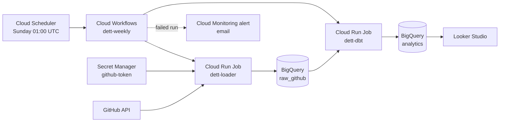

# Data Engineering Tool Trends

An end-to-end data pipeline that tracks how popular open-source data engineering tools are growing, using GitHub activity for 10 projects. It loads raw data into BigQuery, transforms it with dbt, and serves a Looker Studio dashboard. It runs weekly on Google Cloud, with the infrastructure defined in Terraform.

> **Why this project exists:** a portfolio project for remote data engineering roles. It covers ingestion, warehousing, transformation, testing, orchestration, alerting and infrastructure as code.

**Dashboard:** https://datastudio.google.com/s/t2uya-0H1tw

## What it tracks

10 repositories, grouped into comparable categories:

| Category | Tools |
|---|---|
| Orchestration | Airflow, Dagster, Prefect |
| Transformation | dbt-core, SQLMesh |
| Infrastructure | Terraform, OpenTofu |
| Processing / analytics | Spark, DuckDB, Polars |

> Check the grouping against your `repo_labels` seed and edit this table to match it.

For each repo the pipeline collects stargazer history, forks, releases and commits, and turns them into weekly metrics (new stars, forks, commits, releases and gaps between stable releases).

## Architecture



**Flow:** every Sunday at 01:00 UTC (08:00 WIB) the Scheduler starts the workflow. The workflow runs the loader job and waits for it to finish. Only if the loader succeeded does it run the dbt job. If the workflow fails, an alert policy emails me.

### Why these choices

- **Python loader instead of an ingestion tool.** I first tried Airbyte locally, but it kept crashing on my 8 GB machine, so I wrote a small loader with the GitHub API. It gives full control over incremental loading and field trimming.
- **Cloud Run Jobs, not Cloud Run services or functions.** The work is a batch run that finishes and exits, which is what jobs are for.
- **A workflow between the Scheduler and the jobs.** dbt must only run after the loader finishes. Two independent schedules cannot guarantee that order. A workflow can.
- **JSONL for raw files.** Records are written as dicts straight to JSONL and loaded into BigQuery, with no DataFrame step.
- **No service account keys in the cloud.** Cloud jobs use attached service accounts. Key files exist only on my PC for local runs.

## Data flow

### 1. Load (`src/`)

- `github_fetch.py` and `repositories.py` fetch data from the GitHub API and load it into BigQuery dataset `raw_github`, one table per endpoint (`stargazers_history`, `forks`, `releases`, `commits`).
- **Incremental loads:** for stargazers, forks and commits the loader reads the watermark (`MAX` of the date column per repo) from BigQuery itself, with no separate state file, and appends with `>=`. Releases have no date column, so that table is replaced on each run.
- **Fail fast:** the loader raises an error if the GitHub rate limit is too low, if a row count does not match, or if `GCP_PROJECT` or `BQ_DATASET` is missing. Empty files skip the load.
- **Privacy:** commit author names and emails are dropped before loading.
- **Secrets:** the GitHub token is read from Secret Manager as `GITHUB_TOKEN`.

### 2. Transform (`dett_dbt/`)

| Layer | Materialization | Purpose |
|---|---|---|
| Staging | views | Deduplicate each source by key, keep the newest `loaded_at`, convert Unix seconds to timestamps |
| Intermediate | views | Weekly commits, forks and releases, release gaps per stable release |
| Marts | tables | `fct_repo_weekly` and `fct_repo_summary`, which feed the dashboard |

- Weeks start on Sunday (UTC). The current partial week is excluded.
- A `repo_labels` seed maps each repository to a tool name and a category.
- **Tests:** 115 tests pass, including a singular test that checks the summary has one `as_of_week`.
- **Source freshness** on `loaded_at`: warn after 1 day, error after 2 days.
- **Descriptions** use doc blocks, and they explain the data quirks (for example, Spark has no GitHub Releases, and merge and bot commits are present).

### 3. Serve

A Looker Studio dashboard reads the `analytics` marts.

## Repository layout

```
.
├── src/                    # Python loader (GitHub API -> BigQuery)
├── dett_dbt/               # dbt project (staging, intermediate, marts)
├── workflows/
│   └── weekly_pipeline.yaml  # Cloud Workflows definition
├── infra/                  # Terraform
├── Dockerfile              # loader image
└── requirements-loader.txt # pinned loader dependencies
```

> Adjust this tree to match the real folders in your repo (for example, where each Dockerfile lives).

## Run it locally

Local runs use key files for the two service accounts. These are never committed.

```bash
# Loader
python -m venv .venv-loader && source .venv-loader/bin/activate
pip install -r requirements-loader.txt
# set GITHUB_TOKEN, GCP_PROJECT, BQ_DATASET in a local .env (gitignored)

# dbt
cd dett_dbt
# set DBT_KEYFILE, GCP_PROJECT, DBT_DATASET, GCP_LOCATION in dett_dbt/.env
dbt debug
dbt build
```

`profiles.yml` is committed. It contains only `env_var()` references, so it holds no secrets. It has two targets: `dev` (key file) and `cloud` (OAuth, no key).

## Cloud deployment

| Component | Name | Notes |
|---|---|---|
| Region | `asia-southeast1` | Used for everything |
| Images | Artifact Registry `dett-images` | `loader` and `dbt` |
| Loader job | `dett-loader` | Runs as `github-loader`, 512Mi, 10 min timeout |
| dbt job | `dett-dbt` | Runs as `dbt-runner`, 1Gi, 10 min timeout. Runs `dbt source freshness`, then `dbt build`, both with `--target cloud` |
| Workflow | `dett-weekly` | Runs as `workflow-runner`. Runs the loader, then dbt |
| Schedule | `dett-weekly-trigger` | `0 1 * * 0`, time zone `Etc/UTC`, POST to the Workflows executions API as `scheduler-invoker` |
| Alert | `dett-weekly-alert` | Email when a `dett-weekly` execution finishes with status `FAILED` |

**Deploying a new image:** rebuilding an image does not update the job. After pushing, run `gcloud run jobs update <job> --image <image> --region asia-southeast1`. Terraform ignores the image on purpose (see trade-offs).

### Service accounts and permissions

Least privilege, no keys used in the cloud:

| Account | Permissions |
|---|---|
| `github-loader` | BigQuery Data Editor on `raw_github`, BigQuery Job User, Secret Accessor on `github-token` |
| `dbt-runner` | Data Viewer on `raw_github`, Data Editor on `analytics`, BigQuery Job User |
| `workflow-runner` | Cloud Run Invoker on each job, Logs Writer, Cloud Run Viewer (the workflow needs `run.operations.get` to wait for a job) |
| `scheduler-invoker` | Workflows Invoker |

## Alerting

A Cloud Monitoring policy watches the metric "Workflow - Finished execution count" filtered to `workflow_id = dett-weekly` and `status = FAILED`, with a 5 minute window. A failure sends an email with a short note on where to look (Workflows, then Executions, then the newest run).

**Not covered:** a failure on the Scheduler side (for example, the trigger itself failing to call the API) does not produce a failed workflow execution, so this alert would not fire. A second log-based alert could cover it.

## Infrastructure as code (Terraform)

Everything in the pipeline except the secret value, key files and image builds is defined in `infra/`.

| Group | Resources |
|---|---|
| Foundation | 11 enabled APIs, Artifact Registry repo |
| Identity | 4 service accounts, additive IAM grants |
| Data | 2 BigQuery datasets (`prevent_destroy`) |
| Secrets | `github-token` container only, with deletion protection |
| Compute | 2 Cloud Run jobs |
| Orchestration | Workflow (source read from `workflows/weekly_pipeline.yaml`), Scheduler job |
| Monitoring | Email notification channel, alert policy |

### How it was built

The pipeline was built and tested by hand first. Terraform was then added by **importing** the existing resources and running `terraform plan` until it showed no changes, instead of rebuilding anything. Each group was written, imported, planned and applied one at a time.

### Using it

```bash
gcloud auth application-default login      # credentials for Terraform, no key file

# 1. Create the state bucket by hand (versioned), then put its name in the backend block
#    in infra/providers.tf. It is not managed by Terraform, because Terraform
#    cannot store its state in a bucket it has not created yet.

cd infra
cat > terraform.tfvars <<'EOF'
gcp_project_id = "your-project-id"
alert_email    = "you@example.com"
EOF

terraform init
terraform plan
```

`terraform.tfvars` is gitignored, so you must create it. The alert email lives only there and is marked `sensitive`.

> If you apply this to a fresh project rather than importing, push the loader and dbt images first, and add the `github-token` secret version by hand. Terraform manages only the secret container.

### Design decisions

- **Additive IAM resources** (`*_iam_member`) everywhere. Authoritative bindings declare the full member list, so a short list can silently remove existing access.
- **No `access` blocks on the datasets.** The dataset's own `access` setting is authoritative and would fight the additive grants.
- **`deletion_policy = "ABANDON"` on APIs**, so removing one from the list never switches off a service the jobs use.
- **`prevent_destroy` on datasets** and deletion protection on the secret and jobs, so a bad plan cannot delete data.
- **The workflow was recreated, not imported.** `google_workflows_workflow` cannot be imported, so I deleted the workflow and let Terraform create it from the YAML, then tested it end to end. One copy of the YAML means the repo and the cloud cannot drift apart.
- **The GitHub token value is never in Terraform**, because it would sit in plain text in the state file.

## Trade-offs and known limitations

- **Image drift is ignored in Terraform.** I deploy images with `gcloud run jobs update --image`, so the jobs use `ignore_changes` on the image and on gcloud's client fields.
- **Some roles are project-level.** Workflows Invoker and Cloud Run Viewer are granted at project level because the narrower option was not available (Workflows Invoker) or needed broader scope (waiting for a job).
- **The default compute service account still has Editor.** The jobs do not use it.
- **The GitHub token expires.** I keep a calendar reminder to renew it in Secret Manager.
- **No daily snapshot of open issues or watchers.** I skipped that endpoint, so there is no history of those values.
- **A failed workflow does not stop a job that already started.**
- **Job retries are 0.** The Scheduler retries the trigger once. The workflow's connector timeouts (2000 s and 1200 s) are longer than the 10 minute job timeouts.
- **Local key files exist** for `github-loader` and `dbt-runner`, for local runs only. They are gitignored and not used in the cloud.

## Tech stack

Python 3.12 · BigQuery · dbt · Cloud Run Jobs · Cloud Workflows · Cloud Scheduler · Secret Manager · Artifact Registry · Cloud Monitoring · Terraform · Docker · Looker Studio

## License

MIT
